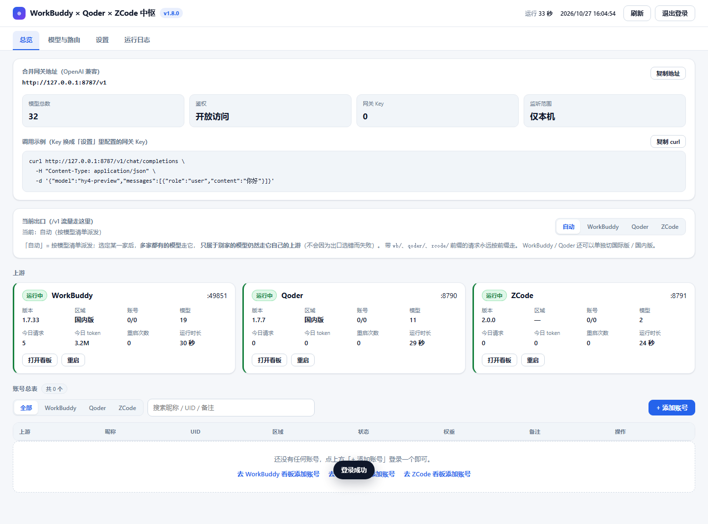

# 融合网关（Hub）操作手册

**一句话定位**：**一个进程、一个端口（默认 `8787`）**同时托管 WorkBuddy、Qoder、ZCode 三套上游，客户端只认一个 Base URL，浏览器只开一个看板——账号登录、启停、切换也都在这个看板里。
*One process, one port — WorkBuddy, Qoder and ZCode behind a single base URL.*

- [为什么有 hub](#为什么有-hub)
- [快速开始](#快速开始)
- [端口与路径](#端口与路径)
- [命令行参数](#命令行参数)
- [环境变量](#环境变量)
- [客户端接入](#客户端接入)
- [模型路由规则](#模型路由规则)
- [账号与数据目录](#账号与数据目录)
- [启停脚本](#启停脚本)
- [常见问题](#常见问题)



*一个进程、一个端口：三张上游卡片、三家合并的账号表（可登录/禁用/删除）、模型路由都在这一页。*

## 为什么有 hub

融合之前是三个独立服务：`wb_proxy.py`（8788）、`qoder_proxy.py`（8790）、`vendor/zcode2api`（8791）。三个进程、三个端口、三个看板、三份 Base URL，换模型就得换地址。

`hub_proxy.py` 把这两件事收成一个入口：

- **一个进程、一个端口**：`python hub_proxy.py` 启动后只有一个 PID，三个上游都在**本进程内**跑（内部端口自动分配，不占固定端口），对外只暴露 8787。任一侧掉线会在面板上标红并可一键重启。
- **`/v1/*` 是合并网关**：请求体里的 `model` 决定派给哪一侧，客户端只配 `http://127.0.0.1:8787/v1`。
- **`/wb/`、`/qoder/`、`/zcode/` 是各自的原始看板**：路径去掉前缀后原样反代，服务端补前缀（HTML 属性、重定向头、fetch shim），三个上游的界面代码一行都不用改。
- **`/` 是新的统一看板** `hub_dashboard.html`：上游状态、账号、模型、路由、Key、运行日志都在这一个页面里。

三个上游仍然是完整可用的独立服务（`wb_proxy.py` / `qoder_proxy.py` / `vendor/zcode2api` 都能单独启动）；中枢只是把它们装进同一个进程、同一个网关。想让中枢只当网关、上游自己另开，用 `--no-spawn` 并告诉它端口（见[常见问题](#常见问题)）。

> **ZCode 需要先装依赖**：`vendor/zcode2api` 是第三方 FastAPI 应用（不是纯标准库），
> 首次使用前执行 `pip install -r vendor/zcode2api/requirements.txt`。
> 只有 Coding Plan（JWT）账号才需要 Node + jsdom 求无痕验证参数：
> `cd vendor/zcode2api/captcha_node && npm install`；API Key 账号不需要。
> 依赖缺失时中枢会在面板上把 ZCode 标成「失败」并直接给出安装命令。

## 快速开始

### Windows

双击 **`start-hub.bat`**：默认后台启动中枢（`pythonw`，无控制台窗口），监听 8787，日志写 `data\hub\logs\hub.log`。

```text
start-hub.bat            默认 8787，后台启动
start-hub.bat 9000       换端口
stop-hub.bat             停止（按 data\hub\hub.pid 精确停止）
```

启动后打开看板 **`http://127.0.0.1:8787/`**，首次用默认密码 `admin` 登录（与两个上游一致），进去后立刻改掉。

### macOS / Linux

```bash
chmod +x start-hub.sh stop-hub.sh    # 只需一次
./start-hub.sh                       # 默认 8787，前台运行，Ctrl+C 停止
./start-hub.sh 9000                  # 换端口
./stop-hub.sh                        # 另开一个终端；按 data/hub/hub.pid 精确停止
```

`start-hub.sh` 是前台进程：窗口关掉 / `Ctrl+C` 就停。要长期跑请用 `nohup`、`systemd` 或 tmux。

### 前台调试

想看两个上游的启动输出，就别用脚本，直接跑：

```bash
python hub_proxy.py --port 8787
```

Windows 上把 `python` 换成 `python\python.exe`（便携版）或 `py`。前台模式同样监听 8787、写同样的日志，只是输出也直接打在终端里。

## 端口与路径

客户端和浏览器只认 `8787`，另外两个端口只用来排障和直接打开原始看板。
*One port for clients; the two upstream ports are for troubleshooting.*

| 端口 / 路径 | 谁在听 | 说明 |
|---|---|---|
| `8787` | 中枢 `hub_proxy.py` | 唯一需要告诉客户端和浏览器的端口 |
| `8788/8790/8791` | 三个上游 | **进程内**运行时由内核自动分配，不对局域网开放（`--wb-port` 等可强制指定） |
| `/v1/*` | 中枢 | 合并网关：OpenAI 兼容 / Responses / Anthropic 三种入口 |
| `/wb/` | 中枢挂载 | WorkBuddy 原始看板（反代到 8788） |
| `/qoder/` | 中枢挂载 | Qoder 原始看板（反代到 8790） |
| `/zcode/` | 中枢挂载 | ZCode 后台管理页（反代到 8791，`/` 会重定向到 `/admin/login`） |
| `/` | 中枢 | 统一看板 `hub_dashboard.html` |
| `/health` | 中枢 | 健康检查，永远不需要鉴权 |

换端口时记得三处一起动：中枢端口、上游端口、客户端里存的 Base URL。

## 命令行参数

```
python hub_proxy.py [--host HOST] [--port PORT] [--lan] [--api-key KEY]
                    [--panel-password PWD] [--wb-port PORT] [--qoder-port PORT]
                    [--zcode-port PORT] [--no-spawn] [--data-dir DIR] [--pid-file FILE]
```

| 参数 | 默认值 | 说明 |
|---|---|---|
| `--host` | `127.0.0.1` | 监听地址 |
| `--port` | `8787` | 中枢监听端口（也认 `HUB_PORT`） |
| `--lan` | 关 | 监听 `0.0.0.0`，强制要求 API Key |
| `--api-key` | 无 | 启动级网关 Key；与面板里配置的 Key **并存**（两种都认） |
| `--panel-password` | 无 | 启动时设置面板密码（不传就沿用 `data/hub/` 里已保存的） |
| `--wb-port` | 自动分配 | 强制 WorkBuddy 上游端口（默认由内核分配） |
| `--qoder-port` | 自动分配 | 强制 Qoder 上游端口 |
| `--zcode-port` | 自动分配 | 强制 ZCode 上游端口（需先装 `vendor/zcode2api` 的依赖） |
| `--no-spawn` | 关 | 只当网关：不启动内置上游，改用 `--wb-port` 等指定的、你自己启动的实例 |
| `--data-dir` | `data/hub` | 中枢自己的数据目录 |
| `--pid-file` | 无 | 把中枢 PID 写入该文件，退出时删除；`stop-hub.bat` / `stop-hub.sh` 依赖它 |

## 环境变量

| 变量 | 作用 |
|---|---|
| `HUB_PORT` | 中枢端口，等价于 `--port` |
| `HUB_DATA_DIR` | 中枢数据目录，等价于 `--data-dir` |
| `HUB_API_KEY` | 网关 Key，等价于 `--api-key` |
| `HUB_MAX_PAYLOAD_BYTES` | 单个请求体的上限（字节），超了直接拒绝 |

命令行参数优先于环境变量。`start-hub.bat` / `start-hub.sh` 也认 `HUB_PORT` 和 `HUB_DATA_DIR`，保证 pid 文件、日志和中枢自己用的是同一个目录。

## 客户端接入

### 通用参数

| 参数 | 值 |
|---|---|
| Base URL | `http://127.0.0.1:8787/v1`；局域网访问换成 `http://<中枢 IP>:8787/v1` |
| API Key | 面板「网关 Key」里生成。本机运行且一个 Key 都没配时，可以留空或随便填 |
| 模型 | 填 `/v1/models` 返回的 `id`，例如 `deepseek-v4.1-flash`；带 `protocol: anthropic` 的（ZCode 的 `GLM-5.2` 等）只能用 Anthropic 端点 |

三个入口共用同一份模型清单和路由规则：`POST /v1/chat/completions`、`POST /v1/responses`、`POST /v1/messages`。

**ZCode 只支持 Anthropic Messages**：它的模型（`GLM-5.2`、`GLM-5-Turbo`）走
`/v1/messages` 正常；用 `/v1/chat/completions` 调它会得到一条明确的
`unsupported_protocol` 错误（而不是让上游回 404 让人猜）。

### OpenAI 兼容

Cherry Studio、Chatbox、NextChat、Kelivo 等客户端，按上面的通用参数填写即可。

```bash
curl http://127.0.0.1:8787/v1/chat/completions \
  -H "Authorization: Bearer <网关 Key>" \
  -H "Content-Type: application/json" \
  -d '{"model":"deepseek-v4.1-flash","messages":[{"role":"user","content":"hi"}]}'
```

### Codex CLI（Responses API）

在 `~/.codex/config.toml` 里加一个 provider：

```toml
model_provider = "hub"
model = "deepseek-v4.1-flash"

[model_providers.hub]
name = "Hub Gateway"
base_url = "http://127.0.0.1:8787/v1"
wire_api = "responses"
env_key = "OPENAI_API_KEY"
```

网关 Key 放在环境变量 `OPENAI_API_KEY` 里，或写入 `~/.codex/auth.json`。

### Claude Code（Anthropic Messages）

Claude Code 会自己在地址后面拼 `/v1`，所以 Base URL **不要带 `/v1`**：

```bash
export ANTHROPIC_BASE_URL="http://127.0.0.1:8787"
export ANTHROPIC_AUTH_TOKEN="<网关 Key>"
export ANTHROPIC_MODEL="deepseek-v4.1-flash"
```

### 模型名怎么选：`qoder/` 前缀是什么

- `/v1/models` 里的 `id` 就是**客户端该填的名字**；响应还带 `provider` 字段，告诉你这条会派到哪一侧。
- 两个上游都有同名模型时，后注册的一侧会加 `qoder/` 前缀（如 `qoder/qmodel_38max`）。这是**消歧**，不是新模型：填这个名字就是明确要走 Qoder，转发前前缀会被剥掉。
- 反过来也可以自己加前缀强制走某一侧：`wb/<模型名>`、`qoder/<模型名>`。前缀永远优先于路由配置。

## 模型路由规则

请求体里的 `model` 按下面的顺序决定上游：

1. 带 `wb/` 或 `qoder/` 前缀 → 强制该上游，转发前剥掉前缀；
2. 面板「路由」里配置了覆盖（`routing.overrides`）→ 按配置走；
3. 两边模型清单里都有 → 走默认上游（`routing.default_provider`，默认 `wb`）；
4. 只在一边有 → 走那一边；
5. 两边都没有 → 走默认上游，由上游自己返回它的 404 / 400。

路由在面板「路由」区改，也可以 `POST /api/hub/settings`（局部补丁，见 [hub-api.md](hub-api.md#4-模型与路由)）。响应（含 SSE 流）原样透传；上游连不上时中枢返回 `502`：

```json
{"error": {"message": "WorkBuddy 上游未就绪（state=failed）", "type": "upstream_unavailable"}}
```

## 一个界面管理三家的账号

看板首页的账号表是**三家合并**的（按上游筛选：全部 / WorkBuddy / Qoder / ZCode）。每一行都能直接
「禁用 / 启用」或「删除」；点右上角「+ 添加账号」就能不离开这个页面登录任意一家：

| 上游 | 添加方式 |
|---|---|
| WorkBuddy | 选区域（国际版 / 国内版）→「开始登录」→ 浏览器完成授权，页面自动轮询到账号入库 |
| Qoder | 同上（设备授权，区域决定用 qoder.com 还是 qoder.com.cn） |
| ZCode | ①「用 Z.AI 授权登录」走它后台的 OAuth；②「粘贴凭证」：每行一个 JWT 或 API Key（可写 `名称<TAB>凭证`） |

- 登录成功后账号表自动刷新，不用重启、不用切页面。
- 账号数据仍然归各自上游管（WorkBuddy `accounts/`、Qoder `data/qoder/accounts/`、ZCode `data/zcode/accounts.db`），
  中枢只是把「入口」收到了一处。
- 中枢读账号表要用上游的面板密码（默认 `admin`，改过的话见下面「账号与数据目录」里的配置说明）。

### 怎么「切换」上游

0. **当前出口（偏好开关）**：看板首页的「当前出口」卡片——`自动 / WorkBuddy / Qoder / ZCode`
   四选一。它的作用是「今天想烧谁的额度」：**多家都有的模型**（例如 `auto`）走选中的那家；
   **只属于别家的模型仍然走它自己的上游**，不会因为出口选错而失败——比如你在用 Qoder 的
   `Qwen3.8-Flash`、出口却设成了 WorkBuddy，请求依旧正确转发到 Qoder。
   选 WorkBuddy 或 Qoder 时旁边还会出现「国际版 / 国内版」，切换会直接写回该上游
   （与它自己看板里的区域开关是同一个状态）。
1. **按请求**：模型名带 `wb/`、`qoder/`、`zcode/` 前缀就强制走那一家（`qoder/auto`）——
   前缀永远优先于当前出口。
2. **按模型**：看板「模型与路由」页给某个模型点一个默认上游（`routing.overrides`）。
3. **默认上游**：同一个页面顶部的「默认上游」下拉——没有前缀、两边都有的模型走它。

> 「模型与路由」表格可以随时刷新：右上角「刷新」按钮，或每次切到该页签都会自动拉一次，
> 表头会显示「更新于 HH:MM:SS」。

## 账号与数据目录

中枢**不搬动**上游的数据，两边还在各自的老位置：

| 内容 | 路径 |
|---|---|
| WorkBuddy 账号 | `accounts/` |
| WorkBuddy 用量流水 | `usage/` |
| Qoder 账号 | `data/qoder/accounts/` |
| Qoder 用量流水 | `data/qoder/usage/` |
| ZCode 账号与设置（SQLite） | `data/zcode/accounts.db` |
| ZCode 后台密钥 | `data/hub/settings.json` 的 `providers.zcode.admin_key`（默认 `zcode`） |
| 中枢数据（面板密码、网关 Key、路由配置、日志） | `data/hub/` |
| 上游日志（面板「运行日志」读的就是这两个） | `data/hub/logs/wb.log`、`data/hub/logs/qoder.log` |
| 中枢自己的输出（启动脚本重定向到这里） | `data/hub/logs/hub.log` |
| 中枢 pid 文件 | `data/hub/hub.pid` |

**合并账号表怎么来的**：WorkBuddy / Qoder 的管理接口在各自「面板会话」闸门后面
（API Key 只进 `/v1`），所以中枢会用它们的**面板密码**登录一次再读账号表，默认
`admin`。如果改过某个上游的面板密码，在 `data/hub/settings.json` 里补一条：

```json
{"providers": {"wb": {"panel_password": "你的密码"},
               "qoder": {"panel_password": "你的密码"}}}
```

配好后重启中枢；没配时账号表会是空的，概览里 `accounts_hint` 会给出这句提示，
网关转发本身不受影响。ZCode 的账号表走它自己的后台密钥（`providers.zcode.admin_key`，默认 `zcode`）。

`--data-dir` / `HUB_DATA_DIR` 只改中枢自己的目录，不影响两个上游。反过来，上游的账号目录用它们自己的参数（`--accounts-dir` / `--usage-dir`），中枢只是把 `--wb-port`、`--qoder-port` 传下去。

首次启动是空账号：打开看板 `http://127.0.0.1:8787/`，点对应上游卡片上的「打开看板」，在**那个上游自己的看板**里用 OAuth 添加账号（中枢只是把两个看板挂到同一端口，账号仍然归各自上游管理）。

## 启停脚本

| 脚本 | 平台 | 行为 |
|---|---|---|
| `start-hub.bat [port]` | Windows | `pythonw` 后台启动中枢；已有实例在跑时只提示「已在运行」；日志 `data\hub\logs\hub.log` |
| `start-hub.sh [port]` | macOS / Linux | 前台启动，写 `data/hub/hub.pid`，`trap` 退出时清理 |
| `stop-hub.bat` | Windows | 按 `data\hub\hub.pid` 精确停止，校验命令行含 `hub_proxy.py`，停完删 pid 文件 |
| `stop-hub.sh` | macOS / Linux | 同上 |

两个 stop 脚本都**只**杀 pid 文件里记录的那一个进程，不做 `taskkill /IM python.exe` 这类模糊匹配——机器上可能同时跑着别的 Python 服务。

## 常见问题

### ZCode 起不来

最常见的是没装依赖：面板上 ZCode 卡片会显示「缺少 Python 依赖（fastapi、…）」，
按提示执行 `pip install -r vendor/zcode2api/requirements.txt` 再点「重启」即可。
Coding Plan 账号报无痕验证失败时，检查 Node 与 `vendor/zcode2api/captcha_node/node_modules` 是否存在。

### 上游起不来，怎么看日志

1. 面板首页的「运行日志」区：按上游筛选，读的是该上游在**本进程内**的日志环形缓冲
   （启动失败的第一行报错通常就在末尾）。
2. 中枢自己的输出在 `data/hub/logs/hub.log`（启动脚本把中枢的 stdout 重定向到这里，
   包含「哪个上游启动失败、为什么」这类守护日志）。
3. 上游状态是 `failed` 时，发往它的请求会拿到 `502 upstream_unavailable`，错误信息里带着上游名和状态。
4. 常见原因：上游端口被别的程序占了、上游账号过期、上游依赖缺失（直接单独跑一次上游就能看到它的完整报错，见[只想跑其中一个上游](#只想跑其中一个上游)）。

### 端口冲突怎么办

- 中枢换端口：`start-hub.bat 9000` / `./start-hub.sh 9000`，或 `--port` / `HUB_PORT`。换完客户端的 Base URL 要跟着改。
- 上游换端口：`--wb-port` / `--qoder-port`，中枢会按新端口拉起上游。
- 查谁占着：
  - Windows：`netstat -ano | findstr :8787`，再按 PID 在任务管理器里对；
  - macOS / Linux：`lsof -nP -iTCP:8787 -sTCP:LISTEN`。
- `start-hub.bat` 启动前会先探一次端口，被别的程序占了会直接提示，不会假装启动成功。

### 局域网模式（`--lan`）的鉴权要求

`--lan` 会监听 `0.0.0.0`，手机、别的电脑都能连，因此：

- **必须有 API Key**：`--api-key sk-...` 或 `HUB_API_KEY`，或先在面板「网关 Key」里生成一个。没有 Key 的匿名请求一律拒绝。
- **面板密码必须改掉默认值**，否则同网段任何人都能进看板。
- 客户端地址换成 `http://<本机局域网IP>:8787/v1`。
- Windows 上第一次可能被防火墙挡住：运行一次 `allow-firewall.bat 8787` 放行 TCP 8787（它会自己弹 UAC 申请管理员权限）。
- 不要把 8787 直接开到公网；要暴露就套 Nginx / Caddy / Cloudflare Tunnel 并加 TLS。

### 只想跑其中一个上游

让中枢只当网关，不碰上游：

```bash
python hub_proxy.py --no-spawn
```

然后在另一个终端里单独启动你要的那一侧：

```bat
rem 只要 WorkBuddy（Windows）
start-wb-proxy.bat
```

```bash
# 只要 WorkBuddy（macOS / Linux）
./start-wb-proxy.sh

# 只要 Qoder
python qoder_proxy.py --port 8790
```

`--no-spawn` 时中枢不拉起也不守护上游，上游的启停、日志、账号全归你自己管；某一侧没起来，发往它的请求就是 502。注意这时中枢**不会**把请求里的 `Authorization` 换成内部密钥（内部密钥只在中枢自己拉起上游时存在），所以单独启动的上游要么不设 `--api-key`，要么就让客户端直接带它那把。

### 双击了两次，会不会起两份

不会。`start-hub.bat` 启动前会先找有没有活着的 `hub_proxy.py` 进程，有就只打印「已在运行」和看板地址，不再起第二份。要重启请先 `stop-hub.bat`。
